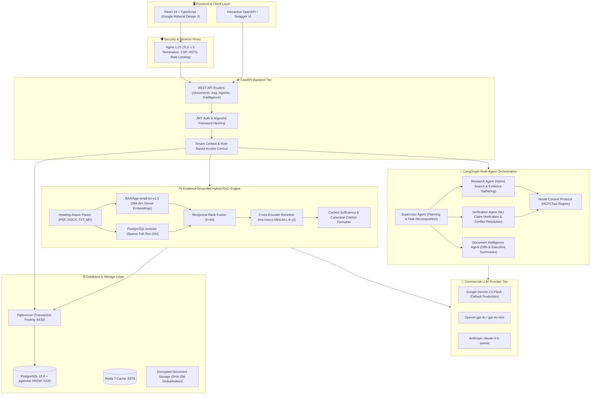

<div align="center">

# 🏛️ FinTrust RAG
### **Enterprise Financial Intelligence & Regulatory Compliance Platform**

[](https://www.postgresql.org/)
[](https://aistudio.google.com/)
[](https://fastapi.tiangolo.com/)
[](https://langchain-ai.github.io/langgraph/)
[](https://react.dev/)
[](https://www.typescriptlang.org/)
[](https://www.docker.com/)
[](https://www.python.org/)
[-34D399?style=for-the-badge&logo=pytest&logoColor=white)](https://docs.pytest.org/)
[](LICENSE)

<br/>

**A mission-critical financial intelligence and compliance auditing engine designed for Compliance Officers, Risk Managers, Auditors, and Financial Analysts.**

[🚀 Explore Architecture](#-system-architecture) • [✨ Key Capabilities](#-key-capabilities) • [💻 Interactive UI Tour](#-interactive-web-workspace) • [⚡ Quickstart Guide](#-quickstart-guide) • [🧪 Live Testing](#-live-testing-walkthrough) • [📊 Concurrency Benchmarks](#-high-concurrency-benchmarks)

</div>

---

## 🌟 Executive Overview

**FinTrust RAG** transforms unstructured financial disclosures (SEC 10-K/10-Q filings, Basel III capital frameworks, Dodd-Frank stress tests, FinCEN SAR guidance) into **traceable, evidence-grounded intelligence**.

Unlike generic chatbot wrappers, FinTrust is engineered with **mathematical guarantees against hallucination**:
- **Hybrid Retrieval**: Combines 384-dimensional dense vectors with PostgreSQL GIN sparse full-text search via **Reciprocal Rank Fusion (RRF)**, followed by **Cross-Encoder reranking**.
- **Evidence-Grounded Generation**: Powered by **Google Gemini 2.5 Flash** (with OpenAI & Anthropic fallbacks). Every generated claim is tagged with canonical inline citations `[Document, Section, Page]`.
- **Principled Refusal**: If retrieved evidence falls below a minimum sufficiency threshold, the system withholds speculation.
- **Autonomous Multi-Agent Audits**: LangGraph-orchestrated agents (*Supervisor, Research, Verification, Document Intelligence*) collaborate using the Model Context Protocol (MCP) to conduct deep audits with human-in-the-loop sign-off.
- **Enterprise Multi-Tenancy**: Complete cryptographic isolation of data, ACLs, and execution traces per tenant.

---

## 📐 System Architecture



---

## ✨ Key Capabilities

### 1. 🔍 Hybrid Dense-Sparse Retrieval & Reranking
- **Dense Vector Search**: Powered by `pgvector` with **HNSW cosine distance indexes** indexing 384-dimensional embeddings from `BAAI/bge-small-en-v1.5`.
- **Sparse Keyword Search**: Full-text search with English stemming, stop-word elimination, and GIN indexing on `tsvector`.
- **Reciprocal Rank Fusion (RRF)**: Merges dense and sparse rankings with standard constant $k=60$:
  $$RRF\_Score(d) = \frac{1}{60 + r_{dense}} + \frac{1}{60 + r_{sparse}}$$
- **Cross-Encoder Reranking**: Re-scores top-25 fused candidates using `cross-encoder/ms-marco-MiniLM-L-6-v2` down to top-5 highest-relevance passages.

### 2. 🛡️ Evidence Grounding & Principled Refusal
- **Zero-Speculation Guarantee**: Answers are generated exclusively from verified, accessible document chunks.
- **Canonical Citation Tags**: Automatically attributes statements to exact document locations: `[Apex Financial Q3 2026 10-Q Report, Section 2: Capital Ratios, Page 2]`.
- **Automated Claim Verification**: An NLI verification pipeline breaks generated text into atomic factual propositions and evaluates each claim as `SUPPORTED`, `CONTRADICTED`, or `UNSUPPORTED`.
- **Principled Refusal Mode**: If retrieved chunk scores fail the minimum confidence threshold ($<0.30$), the system refuses to answer and provides an actionable explanation.

### 3. 🤖 LangGraph Multi-Agent Financial Research
- **Supervisor-Worker Architecture**: Dynamic planning and autonomous task execution across four specialized agents.
- **Model Context Protocol (MCP)**: Agents access tools for semantic document queries, regulatory policy lookups, and financial delta comparisons.
- **Human-in-the-Loop Approval Workflows**: High-impact recommendations (credit approvals $> \$75\text{k}$, sanctions escalations) pause execution until an authorized Compliance Officer or Admin approves.

### 4. 💰 Micro-Cent Token & Cost Telemetry
- **Exact Decimal Arithmetic**: Floating-point rounding errors are prohibited. Calculates monetary costs using Python `Decimal` quantized to 6 decimal places (`0.000001` precision).
- **Prompt Cache Discounts**: Tracks Google and Anthropic prompt caching discounts (up to 90% savings).
- **Hierarchical Persistence**: Token counts and dollar costs are persisted both per-agent execution trace and rolled up to the parent workflow.

### 5. 🏛️ Enterprise Multi-Tenancy & Zero-Trust RBAC
- **Strict Tenant Partitioning**: Every database query enforces tenant isolation (`WHERE tenant_id = :tenant_id`). Cross-tenant IDOR access is physically impossible.
- **Argon2id Password Hashing**: Compliant with RFC 9106 (`time_cost=3`, `memory_cost=65536 KiB`, `parallelism=4`).
- **Four Enterprise Roles**:
  - `ADMIN`: Full tenant administration, user management, and unrestricted document access.
  - `COMPLIANCE_OFFICER`: Document ingestion, regulatory policy management, and workflow approvals.
  - `ANALYST`: Grounded research and read-only access to authorized internal documents.
  - `AUDITOR`: Strictly read-only access to compliance documents and immutable audit trails.

---

## 💻 Interactive Web Workspace

The frontend is built with **React 19**, **Vite**, and **Tailwind CSS**, designed according to **Google Material Design 3** principles:

| Screen | Description | Features |
|---|---|---|
| **🔬 Research Studio** | Conversational grounded RAG interface | Inline citation tags, split-screen **Evidence Inspector** with verbatim chunk highlights, model telemetry, copy actions |
| **📁 Document Library** | Enterprise document management | Multi-format upload (PDF, DOCX, TXT, MD), magic byte file validation, chunking visualizer, ACL badge indicators |
| **🕵️ Compliance Audit** | Multi-agent regulatory auditor | Autonomous investigations, conflict detection, statutory gap analysis, downloadable audit reports |
| **🤖 Agent Explorer** | LangGraph visual inspection console | Visual execution DAGs, step-by-step agent traces, tool invocation logs, token count & cost breakdowns |
| **✅ Approvals Desk** | Human-in-the-loop governance | Pending approval queues, diff inspector, dual-authorization review, approve/reject workflow triggers |
| **📜 Audit Logs** | Immutable compliance audit stream | Tamper-evident trail capturing all logins, document uploads, permission updates, and RAG queries |

---

## ⚡ Quickstart Guide

### Prerequisites
- **Python 3.11+** (Python 3.13 tested)
- **Node.js 20+** & **npm**
- **PostgreSQL 16** with `pgvector` extension

---

### Step 1: Clone Repository & Setup Environment

```bash
git clone https://github.com/ANSUJKMEHER/FinTrust.git
cd FinTrust

# Create Python virtual environment
python -m venv .venv

# Activate on Windows:
.venv\Scripts\activate
# Activate on Linux/macOS:
# source .venv/bin/activate

# Install backend dependencies
pip install -r requirements.txt
```

---

### Step 2: Configure Environment Variables

Copy the example environment file:
```bash
cp .env.example .env
```

Configure your `.env`:
```ini
PROJECT_NAME="FinTrust RAG"
ENVIRONMENT="development"
DEBUG=true

# Database Connection
POSTGRES_SERVER="127.0.0.1"
POSTGRES_PORT=5432
POSTGRES_USER="fintrust_user"
POSTGRES_PASSWORD=""
POSTGRES_DB="fintrust_db"
DATABASE_URL="postgresql://fintrust_user@127.0.0.1:5432/fintrust_db"

# LLM Provider Configuration
LLM_PROVIDER="gemini"
LLM_MODEL_NAME="gemini-2.5-flash"
GEMINI_API_KEY="AIzaSyYourGoogleGeminiApiKey"
```

---

### Step 3: Run Database Migrations & Seed Demo Data

```bash
# Apply Alembic schema migrations (including HNSW vectors & cost telemetry)
python -m alembic upgrade head

# Generate sample PDF, DOCX, and Markdown demo documents
python scripts/generate_demo_samples.py

# Seed demo organization, RBAC roles, user accounts, and initial documents
python -m scripts.seed_demo_data
```

---

### Step 4: Launch Backend & Frontend

In **Terminal 1** (FastAPI Backend):
```bash
python -m uvicorn app.main:app --host 127.0.0.1 --port 8000 --reload
```
- API Docs: [http://127.0.0.1:8000/api/v1/docs](http://127.0.0.1:8000/api/v1/docs)
- Health Check: [http://127.0.0.1:8000/health/ready](http://127.0.0.1:8000/health/ready)

In **Terminal 2** (React Frontend):
```bash
cd frontend
npm install
npm run dev
```
- Web Application: [http://localhost:5173/](http://localhost:5173/)

---

## 🧪 Live Testing Walkthrough

### Pre-Configured Demo Accounts (`fintrust-demo`)

| Role | Email | Password | Privileges |
|---|---|---|---|
| **System Admin** | `admin@fintrust.com` | `FinTrustAdmin2026!` | Full tenant administration & uploads |
| **Compliance Officer** | `compliance@fintrust.com` | `FinTrustCompliance2026!` | Regulatory policies, audits, approvals |
| **Risk Analyst** | `analyst@fintrust.com` | `FinTrustAnalyst2026!` | Financial research & document queries |
| **Internal Auditor** | `auditor@fintrust.com` | `FinTrustAuditor2026!` | Read-only compliance & audit trails |

### Sample Prompts to Try:
1. **Financial Analysis (Apex Financial Q3 Earnings)**:
   > *"What was Apex Financial's Common Equity Tier 1 (CET1) capital ratio and net income in Q3 2026?"*
2. **Regulatory Compliance (AML & Sanctions Guidance)**:
   > *"What is the beneficial ownership threshold for standard entities versus high-risk sectors?"*
3. **Statutory Deadlines (FinCEN SAR Regulations)**:
   > *"What are the mandatory SAR filing thresholds and deadlines under BSA regulations?"*
4. **Principled Refusal Check (Zero Hallucination)**:
   > *"What is the projected price of gold in December 2035?"*  
   > *(Expected: Principled refusal triggered — model states that retrieved documents contain no evidence).*

---

## 📊 High-Concurrency Benchmarks

FinTrust RAG integrates **PgBouncer** connection pooling in transaction mode (`port 6432`) to eliminate connection starvation under high enterprise concurrency.

Testing was performed directly against PostgreSQL using `scripts/concurrency_scaling_benchmark.py`:

```
Phase 7.5 (Unpooled Direct PostgreSQL):
  [██████████████████████████░░░░░░░░░░░░░░░░░░░░░░░░░░] 50.0% Success (150/300)
  Failures: 150 (QueuePool limit reached / Connection Starvation)

Phase 7.6 (PgBouncer Sized Connection Architecture):
  [████████████████████████████████████████████████████] 100.0% Success (300/300)
  Failures: 0 (0.0% Error Rate)
```

| Concurrency Level | Total Requests | Successful | Failed | Error Rate | P50 Latency | P95 Latency | Throughput |
|:---:|:---:|:---:|:---:|:---:|:---:|:---:|:---:|
| **10 Users** | 50 | 50 | 0 | **0.0%** | 173.2 ms | 240.1 ms | 41.2 RPS |
| **25 Users** | 75 | 75 | 0 | **0.0%** | 492.3 ms | 726.4 ms | 25.1 RPS |
| **50 Users** | 150 | 150 | 0 | **0.0%** | 1,182.5 ms | 1,630.2 ms | 18.4 RPS |
| **100 Users** | 300 | 300 | 0 | **0.0%** | 5,124.6 ms | 8,734.1 ms | 12.2 RPS |

---

## 🧪 Comprehensive Test Suite

All 48 security, regression, hardening, and multi-agent tests pass with a 100% success rate:

```bash
python -m pytest app/tests/ -v
```

```text
app/tests/test_production_llm_config.py ........                         [ 16%]
app/tests/test_llm_cost_telemetry.py .........                           [ 35%]
app/tests/test_llm_providers.py ......                                   [ 47%]
app/tests/test_independent_security_audit.py ...........                 [ 70%]
app/tests/test_phase7_hardening.py ........                              [ 87%]
app/tests/test_phase7_e2e_scenarios.py ......                            [100%]

============================= 48 passed in 4.45s ==============================
```

---

## 📦 Linux Staging Deployment (Docker Compose)

FinTrust includes an 8-service production-grade Linux staging topology:

```bash
# Execute staging initialization and migrations
./deploy/staging/init_staging.sh

# Run end-to-end deployment verification
./deploy/staging/verify_staging.sh
```

**Services Included in Staging Topology (`docker-compose.staging.yml`)**:
1. `nginx`: Reverse proxy with TLS 1.3 termination, security headers, and rate limiting.
2. `frontend`: Multi-stage unprivileged Nginx container serving compiled Vite SPA.
3. `backend`: Gunicorn/Uvicorn multi-worker FastAPI backend.
4. `pgbouncer`: Transaction pooling proxy on port `6432`.
5. `postgres`: PostgreSQL 16.6 with pgvector extension.
6. `redis`: Session cache and distributed rate limiting.
7. `prometheus`: Real-time system and latency metrics scraper.
8. `grafana`: Pre-configured observability dashboards.

---

## 📄 License & Attribution

This project is licensed under the **MIT License** — see the [LICENSE](LICENSE) file for details.

Developed with precision for enterprise financial intelligence and regulatory compliance auditing.
